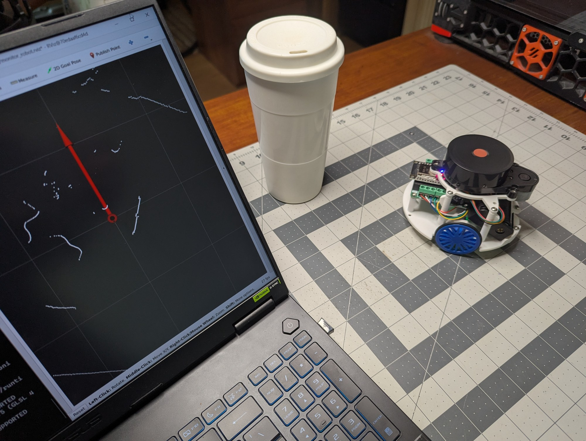
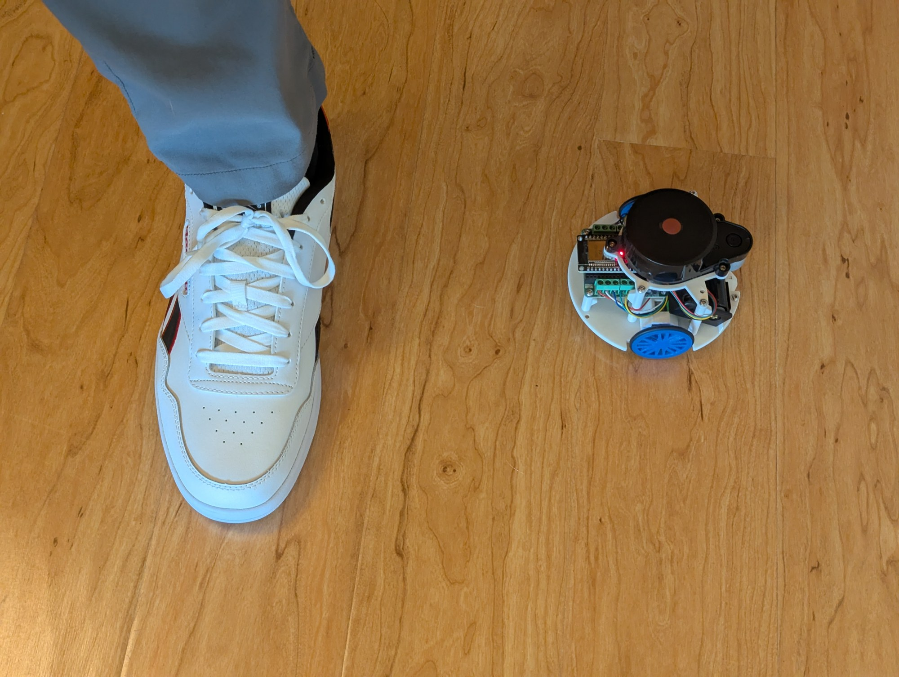

# 7. Program Your Robot

In this chapter you write and run two short Python programs:

- **Face the closest object.** The robot turns in place toward anything within 25 cm. It's small
  enough to try on your desk.
- **Follow me.** The robot follows the closest object in front of it, staying 40 cm away. Walk
  slowly and it follows your feet.

You try each program in the simulation first (Chapter 6), then on the real robot. No robotics theory
is needed: you copy the code, run it and watch the robot. A short explanation follows each program.

## How a robot program talks to the robot

The robot software is built on ROS 2, where programs exchange messages on named *topics*. Your
programs use just two:

- `/scan`: the LiDAR's distance readings, one full circle about five times a second.
- `/cmd_vel`: drive commands, a forward speed and a turning speed. The keyboard teleop app from
  Chapter 3 sends its commands here too.

Each program reads `/scan`, decides how to move, and sends a command to `/cmd_vel`. The same program
works in the simulation and on the real robot.

## Set up a folder for your code

The robot software runs in a Docker container, and everything you save inside it is lost when the
container exits. Keep your programs on your PC instead and share the folder with the container.

1. Create the folder `C:\robot_code`.
2. Start the container for the simulation as in Chapter 6, with one more `-v` option for the code
   folder:

    ```
    docker run --name makerspet -it --rm -v c:\maps:/root/maps -v c:\robot_code:/root/code -p 8888:8888/udp -e DISPLAY=host.docker.internal:0.0 -e LIBGL_ALWAYS_INDIRECT=0 kaiaai/kaiaai:iron
    ```

    Inside the container, `C:\robot_code` appears as `/root/code`.

3. Download both programs into it:

    ```
    cd /root/code
    curl -O https://raw.githubusercontent.com/makerspet/ebook/main/self-driving/v1/book/code/face_closest.py
    curl -O https://raw.githubusercontent.com/makerspet/ebook/main/self-driving/v1/book/code/follow_me.py
    ```

    You can also type them in from this chapter: save each one in `C:\robot_code` with any text
    editor, for example Notepad, choosing **All files** as the file type.

!!! note "Ubuntu PC"
    Use the Ubuntu `docker run` command from Chapter 8 with `-v ~/robot_code:/root/code` added,
    and keep your programs in `~/robot_code`.

## Program 1: face the closest object

### Try it in the simulation

1. In the first container terminal, start the simulated world:

    ```
    ros2 launch kaiaai_gazebo world.launch.py
    ```

2. In a second container terminal, place the red ball 30 cm to the robot's right:

    ```
    ros2 run gazebo_ros spawn_entity.py -entity ball -database red_ball_10in -x -2.0 -y -0.8
    ```

    The robot starts at `x = -2.0`, `y = -0.5`, facing along `x`. Always place objects so they
    don't overlap the robot; a ball spawned on top of it knocks the robot away.

3. Run the program:

    ```
    cd /root/code
    python3 face_closest.py
    ```

4. Watch the robot turn right until it faces the ball. The terminal shows what the robot sees,
   with `0` meaning straight ahead:

    ```
    closest: 0.17 m at  -1 degrees
    ```

5. In the Gazebo window, press **T** (translate mode), drag the ball to another spot near the
   robot, and watch it turn again. Anything further than 25 cm away is ignored.
6. Press **Ctrl+C** to stop the program. It stops the wheels before it exits.

### The program

```python
"""Turn in place to face the closest object within 25 cm.

Run inside the robot software's container:  python3 face_closest.py
Stop with Ctrl+C.
"""
import math

import rclpy
from rclpy.node import Node
from rclpy.qos import qos_profile_sensor_data
from rclpy.signals import SignalHandlerOptions
from geometry_msgs.msg import Twist
from sensor_msgs.msg import LaserScan

MAX_DISTANCE = 0.25  # meters: ignore anything further away
TURN_SPEED = 1.0     # radians per second, at most
ON_TARGET = math.radians(5)  # close enough: stop turning


def robot_angle(scan, i):
    """Angle of scan point i as seen by the robot: 0 = straight ahead, + = left, - = right.

    The robot's LiDAR is mounted upside down, so its angles run the other way around,
    starting from the back. 180 degrees minus the scan angle fixes both.
    """
    a = math.pi - (scan.angle_min + i * scan.angle_increment)
    return math.atan2(math.sin(a), math.cos(a))  # wrap to -180..180 degrees


class FaceClosest(Node):
    def __init__(self):
        super().__init__('face_closest')
        self.cmd = self.create_publisher(Twist, 'cmd_vel', 10)
        self.create_subscription(LaserScan, 'scan', self.on_scan, qos_profile_sensor_data)

    def on_scan(self, scan):
        # Find the closest valid point within MAX_DISTANCE.
        closest, angle = MAX_DISTANCE, None
        for i, r in enumerate(scan.ranges):
            if scan.range_min < r < closest:
                closest, angle = r, robot_angle(scan, i)
        twist = Twist()
        if angle is not None:
            print(f'closest: {closest:.2f} m at {math.degrees(angle):4.0f} degrees')
            if abs(angle) > ON_TARGET:
                # Turn toward it: left for positive angles, right for negative ones.
                twist.angular.z = max(-TURN_SPEED, min(TURN_SPEED, 2.0 * angle))
        self.cmd.publish(twist)  # an empty Twist means "stop"


def main():
    rclpy.init(signal_handler_options=SignalHandlerOptions.NO)  # we handle Ctrl+C ourselves
    node = FaceClosest()
    try:
        rclpy.spin(node)
    except KeyboardInterrupt:
        pass
    node.cmd.publish(Twist())  # stop the wheels before exiting
    node.destroy_node()
    rclpy.try_shutdown()


if __name__ == '__main__':
    main()
```

### How it works

- `on_scan` runs every time a new LiDAR scan arrives on `/scan`.
- The loop goes through all the distance readings and keeps the closest one under 25 cm.
- `robot_angle` turns the reading's position in the scan into an angle around the robot:
  `0` straight ahead, positive to the left, negative to the right.
- If the object is more than 5 degrees off, the robot turns toward it. The turning speed grows with
  the angle, so it slows down as it lines up. `twist.angular.z` is the turning speed.
- Publishing an empty `Twist` to `/cmd_vel` stops the robot.

### Try it on the robot

1. Bring up the robot as in Chapter 3, starting the container with the code folder added:

    ```
    docker run --name makerspet -it --rm -v c:\maps:/root/maps -v c:\robot_code:/root/code -p 8888:8888/udp -p 4430:4430/tcp -e DISPLAY=host.docker.internal:0.0 -e LIBGL_ALWAYS_INDIRECT=0 kaiaai/kaiaai:iron
    ```

    Then run `ros2 launch kaiaai_bringup physical.launch.py` and turn the robot on.

2. Place the robot on your desk, away from walls and other objects.
3. In a second container terminal, run `python3 /root/code/face_closest.py`.
4. Hold your hand or a small object, such as a cup, about 15–20 cm from the robot and move it
   around. The robot turns to face it. With a cup placed to the robot's front left, the output
   looks like this:

    ```
    closest: 0.14 m at   52 degrees
    closest: 0.14 m at   52 degrees
    ...
    closest: 0.14 m at   -2 degrees
    ```

    The cup starts 52 degrees to the left; once the robot faces it, the angle drops to about 0 and
    the robot stops.

    


!!! tip "Which way is front?"
    Before relying on the robot's moves, check the printout: hold an object in front of the robot
    and it should read about `0 degrees`; to its left, about `90`; to its right, about `-90`.

## Program 2: follow me

### Try it in the simulation

1. Start a fresh simulation (`Ctrl+C` and relaunch `world.launch.py`) so the robot is back at its
   starting spot, facing along `x`.
2. Place the ball 70 cm in front of the robot:

    ```
    ros2 run gazebo_ros spawn_entity.py -entity ball -database red_ball_10in -x -1.3 -y -0.5
    ```

3. Run the program:

    ```
    python3 /root/code/follow_me.py
    ```

4. The robot drives toward the ball and stops about 40 cm from it:

    ```
    following: 0.40 m at    3 degrees
    ```

5. In Gazebo, drag the ball (**T**) a little further away or to the side. The robot follows. Drag it
   closer and the robot backs up.
6. Press **Ctrl+C** to stop.

### The program

```python
"""Follow the closest object in front of the robot, staying 40 cm away.

Run inside the robot software's container:  python3 follow_me.py
Stop with Ctrl+C.
"""
import math

import rclpy
from rclpy.node import Node
from rclpy.qos import qos_profile_sensor_data
from rclpy.signals import SignalHandlerOptions
from geometry_msgs.msg import Twist
from sensor_msgs.msg import LaserScan

KEEP_DISTANCE = 0.40   # meters: how far behind to stay
SEE_DISTANCE = 1.00    # meters: ignore anything further away
SEE_ANGLE = math.radians(30)  # look 30 degrees to each side of straight ahead
MAX_SPEED = 0.15       # meters per second
MAX_TURN = 1.0         # radians per second


def robot_angle(scan, i):
    """Angle of scan point i as seen by the robot: 0 = straight ahead, + = left, - = right.

    The robot's LiDAR is mounted upside down, so its angles run the other way around,
    starting from the back. 180 degrees minus the scan angle fixes both.
    """
    a = math.pi - (scan.angle_min + i * scan.angle_increment)
    return math.atan2(math.sin(a), math.cos(a))  # wrap to -180..180 degrees


class FollowMe(Node):
    def __init__(self):
        super().__init__('follow_me')
        self.cmd = self.create_publisher(Twist, 'cmd_vel', 10)
        self.create_subscription(LaserScan, 'scan', self.on_scan, qos_profile_sensor_data)

    def on_scan(self, scan):
        # Find the closest point in the cone in front of the robot.
        closest, angle = SEE_DISTANCE, None
        for i, r in enumerate(scan.ranges):
            a = robot_angle(scan, i)
            if abs(a) < SEE_ANGLE and scan.range_min < r < closest:
                closest, angle = r, a
        twist = Twist()
        if angle is not None:
            print(f'following: {closest:.2f} m at {math.degrees(angle):4.0f} degrees')
            # Drive to close the gap (back up if too close) and steer toward the target.
            twist.linear.x = max(-MAX_SPEED, min(MAX_SPEED, 0.8 * (closest - KEEP_DISTANCE)))
            twist.angular.z = max(-MAX_TURN, min(MAX_TURN, 2.0 * angle))
        self.cmd.publish(twist)  # nothing in sight: stop


def main():
    rclpy.init(signal_handler_options=SignalHandlerOptions.NO)  # we handle Ctrl+C ourselves
    node = FollowMe()
    try:
        rclpy.spin(node)
    except KeyboardInterrupt:
        pass
    node.cmd.publish(Twist())  # stop the wheels before exiting
    node.destroy_node()
    rclpy.try_shutdown()


if __name__ == '__main__':
    main()
```

### How it works

- The robot only looks at a 60-degree cone straight ahead (`SEE_ANGLE`, 30 degrees to each side) and
  up to 1 m away (`SEE_DISTANCE`). Whatever is closest in that cone is what it follows.
- The forward speed depends on the gap: too far, drive forward; too close, back up; at 40 cm
  (`KEEP_DISTANCE`), stand still. `twist.linear.x` is the forward speed.
- The turning speed steers toward the object, as in Program 1.
- If nothing is in the cone, the robot stops.

### Try it on the robot

1. Bring up the robot as in Program 1 and put it on the floor in an open space.
2. Stand about 60 cm in front of it and run `python3 /root/code/follow_me.py`.
3. Step back slowly. The robot follows your feet. Step toward it and it backs up.
   Here's the output with my foot in front of the robot, moving it around:

    ```
    following: 0.66 m at   25 degrees
    following: 0.55 m at   -2 degrees
    following: 0.57 m at   30 degrees
    following: 0.37 m at   -4 degrees
    following: 0.29 m at    0 degrees
    ```

    

4. Press **Ctrl+C** to stop.

!!! warning
    Keep the area clear, start slowly and keep a hand near **Ctrl+C**. The robot follows whatever is
    closest in front of it, which may be a chair leg rather than you.

## Make it yours

Every setting is a named value at the top of each program. Change one, save the file and run the
program again:

- **Face the closest object:** set `MAX_DISTANCE = 0.5` to react to objects up to 50 cm away.
- **Follow me:** set `KEEP_DISTANCE = 0.6` to stay further back, or `SEE_ANGLE = math.radians(15)`
  for a narrower view that's less likely to pick up a chair leg.
- **Speed:** lower `TURN_SPEED`, `MAX_SPEED` or `MAX_TURN` for gentler moves.

Keep `MAX_SPEED` well below the robot's top speed of about 0.4 m/s.

## Let an AI assistant drive your robot

An AI coding assistant that can run commands on your PC, such as Claude Code, can control the robot
through the same container: look at the LiDAR scan, run your programs and send drive commands, all
from plain-English requests. That's how the programs in this chapter were tested on a real robot.

1. Install an AI coding assistant that can run terminal commands on your PC.
2. Bring up the robot as in Chapter 3, so the `makerspet` container is running and the robot is
   connected.
3. Give the assistant the facts it needs and your safety rules in your first message:

    ```
    My robot's software runs in a Docker container named makerspet, and the robot is connected.
    Run commands in it with: docker exec makerspet bash -lc "<command>"
    The LiDAR scan is on /scan; drive commands go to /cmd_vel (geometry_msgs/Twist).
    Scan angles are mirrored: the angle around the robot is 180 degrees minus the scan angle.
    Rules: look before you move, keep speed under 0.15 m/s, limit every motion to 15 seconds,
    and always finish by publishing a zero Twist to /cmd_vel.
    First, tell me what the robot sees within 50 cm.
    ```

4. Then ask for what you want, for example:
    - "I placed a cup next to the robot. Where is it?"
    - "Copy face_closest.py into the container and run it for 15 seconds."
    - "I put my foot in front of the robot. Make it follow my foot for 10 seconds."

!!! warning
    AI assistants make mistakes. Review each command before you approve it, keep the robot on the
    floor and away from edges, and keep a hand near the power switch.
